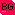
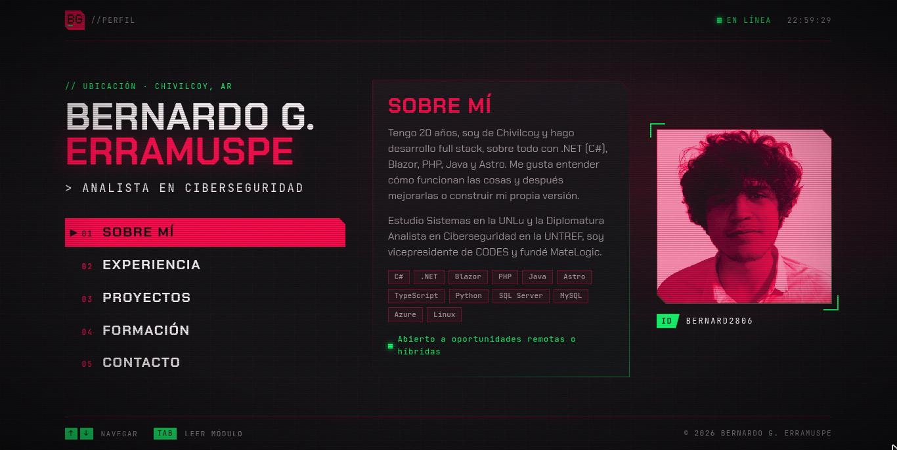

<div align="center">



# Bernardo G. Erramuspe

**Desarrollador full stack · Analista en ciberseguridad**<br>
Chivilcoy, Buenos Aires, Argentina 🇦🇷

[](https://bernard2806.is-a.dev)
[](https://www.linkedin.com/in/bernardo-gonzalez-erramuspe/)
[](https://github.com/Bernard2806)

<br>

<a href="https://bernard2806.is-a.dev"></a>

</div>

<br>

Mi perfil personal, armado como el **menú de un videojuego cyberpunk**: un HUD con la paleta de Capri (*Cyberpunk: Edgerunners 2*), glitches, pixelado y scanlines, pero sin dejar de funcionar como portafolio.

## ✨ Qué tiene

- **Glitch hecho por código.** El nombre y la foto se "rompen" en ráfagas al azar, como el video de cyberpunk.net: franjas desplazadas, macrobloques corridos, chorreado vertical de píxeles y canales rojo y verde separados.
- **Foto normal al pasar el mouse.** La foto se rompe y aparece la original, nítida y sin efectos, para que sirva como foto de portafolio. En celular, con un toque.
- **Menú navegable con el teclado.** ↑ ↓ desde cualquier parte de la página. Los paneles se cambian disolviéndose en bloques de píxeles y el título se "descifra".
- **Estado en vivo.** La barra superior muestra *en línea*, *ocupado hasta tal hora* o *fuera de línea* según mi horario semanal, en hora de Argentina.
- **Rol que se reescribe** como en una terminal: *desarrollador full stack* ⇄ *analista en ciberseguridad*.
- **Pensado para celular y accesible.** De 320 px a pantallas anchas, menú con semántica de pestañas para lectores de pantalla, y todos los efectos se calman con `prefers-reduced-motion`.

## 🛠️ Stack

| | |
|---|---|
| **Framework** | [Astro 7](https://astro.build) con TypeScript estricto y `astro check` en el build |
| **Efectos** | Canvas 2D, CSS y custom elements, sin librerías de animación |
| **Fuentes** | Chakra Petch y JetBrains Mono, servidas desde el sitio con la API de fuentes de Astro |
| **Imágenes** | `astro:assets` + sharp (la foto pasa de 1,7 MB a un webp de 30 kB) |
| **Despliegue** | GitHub Pages con GitHub Actions |
| **Paquetes** | pnpm |

## 🚀 Desarrollo

Necesitás **Node.js 24** o superior y **pnpm**.

```bash
git clone https://github.com/Bernard2806/Perfil.git
cd Perfil
pnpm install
pnpm dev        # http://localhost:4321
```

| Comando | Qué hace |
|---|---|
| `pnpm dev` | Levanta el servidor de desarrollo. |
| `pnpm check` | Chequea los tipos con `astro check`. |
| `pnpm build` | Chequea los tipos y genera el sitio estático en `dist/`. |
| `pnpm preview` | Sirve localmente la versión compilada. |

## 🗂️ Estructura

```text
src/
├── data/
│   ├── site.ts           # perfil, experiencia, proyectos, formación y contacto
│   └── horario.ts        # cuándo figuro ocupado (sin materias ni lugares)
├── components/
│   ├── GlitchPortrait    # foto en duotono con glitch y versión normal
│   ├── GlitchText        # texto que se rompe en franjas
│   ├── MainMenu          # menú estilo juego con transición de píxeles
│   ├── PanelContenido    # contenido de cada sección del menú
│   ├── RolRotativo       # rol que se reescribe como en una terminal
│   └── HudHeader/Footer  # barras del HUD: estado, reloj y atajos
├── lib/fx.ts             # utilidades de efectos (ráfagas, descifrado)
└── assets/bernardo.jpg   # foto de perfil
```

## ✏️ Editar el contenido

- **Textos, experiencia, proyectos y contacto:** `src/data/site.ts`.
- **Horario del estado en línea:** `src/data/horario.ts`, que se actualiza a mano cada cuatrimestre.
- **Foto:** reemplazá `src/assets/bernardo.jpg`. Astro la optimiza al compilar.
- **Analytics y Search Console (opcional):** copiá `.env.template` como `.env` y completá los valores.

## 📦 Despliegue

Cada push a `main` dispara [`deploy.yml`](.github/workflows/deploy.yml), que compila el sitio y lo publica en GitHub Pages bajo **[bernard2806.is-a.dev](https://bernard2806.is-a.dev)**.

## 🎨 Créditos

La estética está inspirada en los menús de *Cyberpunk 2077* y en los colores de Capri, de *Cyberpunk: Edgerunners 2*. El diseño, los efectos y el logo son propios: no se usan logos, tipografías ni recursos oficiales de CD Projekt.

## 📄 Licencia

Este proyecto no declara una licencia de software. Consultame antes de reutilizar el código, el contenido o los recursos visuales.
